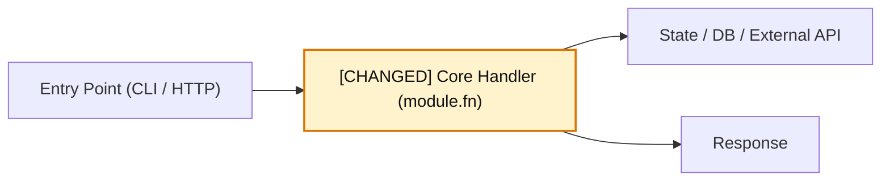

# PR Explanation Template

Use this structure to deliver a high-readability, low-cognitive-load walkthrough for human reviewers. Omit empty subsections rather than padding with filler.

---

## 1. TL;DR & Risk/Effort Header

- **Problem**: One sentence describing the bug, gap, or requirement driving this change.
- **Solution**: One sentence describing the core architectural or behavioral change.
- **Impact**: One sentence describing user-facing, API, data, or operational impact.

| Metric | Value | Notes |
|---|---|---|
| **Review Effort** | `X / 5` | `1` trivial · `2` straightforward · `3` moderate · `4` complex · `5` deep/high-stakes |
| **Merge Risk** | `Low` \| `Medium` \| `High` \| `Critical` | Based on blast radius, reversibility, and state/security impact |
| **Scope** | `N files (+A / -D)` | Key modules touched (e.g., `auth`, `installer`, `tests`) |

---

## 2. Visual Flow / Architecture Diagram

Choose `sequenceDiagram` (cross-component interactions) or `flowchart LR` (data/control pipeline) tracing **entry point → modified functions → DB/API/state boundaries**. Highlight changed nodes/steps with a label prefix like `[CHANGED]` or `[NEW]` and a Mermaid `style`/`classDef`.

---

## 3. Guided Tour (Dependency / Flow Reading Order)

Walk the reviewer through changes in comprehension order, not alphabetical file order:

### 3.1 Data Contracts / Interfaces
- `path/to/types.ext:10-28` — `TypeOrInterface`
  - **Before**: Previous schema, signature, or contract.
  - **After**: Updated schema, signature, or invariant and why callers care.

### 3.2 Core Logic
| Symbol & Location | Before | After |
|---|---|---|
| `core_fn` (`path/to/core.ext:40-72`) | Old behavior / assumption | New behavior, guard clauses, and edge-case handling |

### 3.3 Integration / API / UI
- `path/to/handler.ext:15-50` — `route_or_component`
  - **Before**: Previous wiring or UX flow.
  - **After**: Updated wiring, error handling, or backward-compatibility path.

### 3.4 Tests
- `path/to/test_file.ext:20-65` — New or updated assertions and edge cases covered.

---

## 4. Review Hotspots

### 🔴 Critical / High-Risk (Inspect Carefully)
- **Logic / Security / Concurrency / State**: `path/to/file.ext:45-60` — Explain the exact failure mode, invariant, or trust boundary the reviewer should verify.

### 🟡 Design Trade-offs & Assumptions
- **Trade-off**: `path/to/file.ext:80-95` — Explain what alternative was not chosen, what assumption holds, and when it would need revisiting.

### 🟢 Skippable Boilerplate / Mechanical / Generated

N mechanical or low-risk files (click to expand)

- `path/to/lockfile-or-docs`: Mechanical rename, formatting, or generated metadata with no runtime impact.

---

## 5. Verification & Uncovered Gaps

### Executed Checks
- `command run` — Pass / Fail / Not run (include concise scope, e.g., `12 tests passed`).

### Uncovered Gaps & Manual Verification Checklist
- [ ] Uncovered edge case, environment dependency, or integration path not exercised by automated tests.
- [ ] Manual check recommended before merge (e.g., live UI, migration dry-run, external API).

---

## Formatting & Link Hygiene Rules

1. **Mermaid safety**: Always quote node labels containing parentheses, brackets, colons, or spaces (e.g., `Node["Label (Detail)"]`). Never embed raw HTML tags (` `, `<b>`, ``) inside Mermaid labels.
2. **Code references**: Cite code as repo-relative `path:start-end` so the terminal can open it; never use local `file://` links.
3. **PR comment drafts**: When the user wants to post the walkthrough, hand over a draft with repo-relative paths (e.g., `` `scripts/install.py:41-68` ``) or GitHub PR file links. The user posts it.
4. **Read-only discipline**: Never edit repository files, approve, or merge PRs during a walkthrough; keep findings descriptive so `review` remains the verdict owner.
